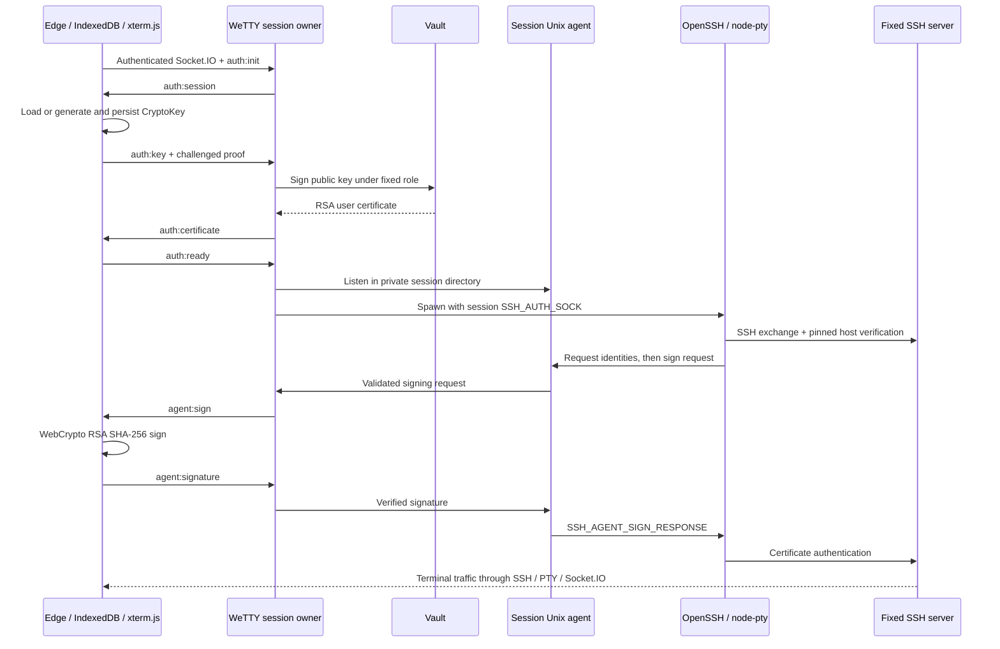

# Browser-backed SSH authentication design

Status: design only; no implementation changes. Inspected 2026-09-10, local
commit `06cc0b7`
(`fix: validate client resize payload before resizing the PTY (#685)`), package
version 3.0.0, origin `https://github.com/butlerx/wetty.git`. The working tree
was clean. This describes this checkout, not an assertion that it matches
upstream HEAD.

The proposed mode preserves xterm.js, node-pty, and system OpenSSH. A backend
agent adapter exposes one session's Vault-signed RSA user certificate through a
private Unix socket. OpenSSH reaches it through the child process's
`SSH_AUTH_SOCK`; the adapter relays signing requests on that session's
authenticated Socket.IO connection. Edge signs with a persisted, non-extractable
WebCrypto private key. No JavaScript SSH transport library or backend user
private key is needed.

## Existing execution paths and required changes

Paths below are relative to the repository root; symbols identify the inspected
code paths. Proposed files are explicitly marked new.

| Existing file and code path                                                                                         | Observed behavior and proposed modification                                                                                                                                                                                                                                                                                                                                                                                            |
| ------------------------------------------------------------------------------------------------------------------- | -------------------------------------------------------------------------------------------------------------------------------------------------------------------------------------------------------------------------------------------------------------------------------------------------------------------------------------------------------------------------------------------------------------------------------------- |
| `src/main.ts`: yargs → `loadConfigFile` → `mergeCliConf` → `start`                                                  | Add an explicit browser-agent mode and pass its validated configuration to startup. CLI must not silently inherit incompatible legacy authentication settings.                                                                                                                                                                                                                                                                         |
| `src/shared/interfaces.ts`, `src/shared/defaults.ts`, `src/shared/config.ts`                                        | Add a separate typed browser-agent configuration and startup validation. Current defaults include password authentication, `/dev/null` known-hosts, and optional local login. Preserve legacy defaults outside the new mode. Avoid mutating shared defaults when merging the new configuration.                                                                                                                                        |
| `src/server.ts`: `start`, `decorateServerWithSsh`, `io.on('connection')`                                            | Currently immediately calls `getCommand` and `spawn`. Introduce a per-socket session owner; authenticate/authorize first, wait for browser key and certificate preparation, then start OpenSSH. Move connection gauge decrement into exactly-once cleanup: currently it only happens in the setup catch. Provide an optional trailing integration-options argument to the exported API so existing positional calls remain compatible. |
| `src/server/socketServer.ts`: `server`                                                                              | Thread authentication integration and mode configuration into listener creation; protect the application entry route. Browser-agent mode should reject `/ssh/:user` routes.                                                                                                                                                                                                                                                            |
| `src/server/socketServer/socket.ts`: `listen`                                                                       | Currently creates Socket.IO with only path/ping settings: **there is no application authentication middleware here**. Register authentication and authorization middleware before accepting connections, and validate handshake origins for polling and WebSocket transports.                                                                                                                                                          |
| `src/server/command.ts`: `getCommand`, `urlArgs`                                                                    | New mode branches before the root/localhost local-login shortcut, `address`, and URL overrides. Derive destination and command solely from validated server configuration. `pass` is currently accepted from the referrer even when remote host/command options are disabled.                                                                                                                                                          |
| `src/server/command/address.ts`: `address`; `src/server/login.ts`: `login`; `src/server/command/login.ts`           | Bypass these legacy paths in browser-agent mode. `remote-user` and `/ssh/:user` currently take precedence over configured SSH user; a missing user prompts through another PTY. Neither is appropriate for a fixed destination. No implementation changes inside the bypassed files are required.                                                                                                                                      |
| `src/server/command/ssh.ts`: `sshOptions`                                                                           | Add a dedicated builder for the fixed browser-agent invocation, including certificate-only SHA-256 public-key policy, strict host verification, and disabled fallback/multiplexing/forwarding. Keep executable and arguments separate.                                                                                                                                                                                                 |
| `src/server/spawn.ts`: `spawn`                                                                                      | Accept explicit executable, argv, per-session environment and lifecycle callbacks/handle for the new mode. Spawn system SSH directly through node-pty; the legacy `/usr/bin/env -S` path need not change. Return a disposable PTY handle instead of treating setup completion as process completion. Replace broad `removeAllListeners` with removal of owned callbacks; include `commit`.                                             |
| `src/server/shared/xterm.ts`: `xterm`                                                                               | Current module-level options copy the entire process environment. Build fresh PTY options for each browser-agent session, retaining terminal dimensions/name but using an allowlisted environment and its unique `SSH_AUTH_SOCK`. Never mutate `process.env` or the shared `xterm` object.                                                                                                                                             |
| `src/server/flowcontrol.ts`: `tinybuffer`, `FlowControlServer`                                                      | Retain terminal flow control; expose timer cancellation/disposal for buffered output. Signing events bypass terminal buffering and `commit` accounting.                                                                                                                                                                                                                                                                                |
| `src/client/wetty/socket.ts`: exported socket                                                                       | Use `autoConnect: false` so handlers and signer state exist before connecting. Explicitly disable session resumption/replay for browser-agent mode. Retain base-path handling.                                                                                                                                                                                                                                                         |
| `src/client/wetty.ts`: `connect` handler                                                                            | Separate terminal setup from authenticated key preparation. Install signer listeners once; gate terminal input until PTY creation; preserve `data`, `input`, `resize`, `commit`, `login`, `logout` semantics. Dispose old callbacks/terminal on session end rather than adding another set on reconnect.                                                                                                                               |
| `src/client/wetty/disconnect.ts`, `src/client/wetty/term.ts`                                                        | Extend disposal to signer state, xterm subscriptions, resize callbacks and terminal instance. Keep stable references for window listeners. A reconnect starts a new SSH session.                                                                                                                                                                                                                                                       |
| `src/server/socketServer/security.ts`, `src/server/socketServer/html.ts`, `src/client/wetty/term.ts`                | Current CSP allows inline scripts and eval, and HTML uses inline click handlers. For browser-agent mode replace those handlers with registered listeners, escape rendered title/base values, and remove unsafe script allowances after browser verification. Audit same-origin options iframe assets as part of that verification. Apply security headers before static routes as well.                                                |
| `src/assets/sw.js`, `src/client/wetty.ts` service-worker registration                                               | Current worker caches arbitrary successful fetches, including application HTML. Restrict it to a versioned static GET allowlist; never cache authentication, session, Socket.IO or Vault responses. Include migration of already installed workers/caches; disabling new registration alone does not remove an existing worker.                                                                                                        |
| `conf/config.json5`, `docs/flags.md`, `docs/API.md`, `docs/auto-login.md`, `docs/development.md`, `docs/sidebar.md` | Document mode configuration, integration contract, excluded URL overrides, browser persistence and operational setup; link this design. These are future implementation changes, not edits made by this design task.                                                                                                                                                                                                                   |
| `package.json`, `pnpm-lock.yaml`, `.github/workflows/build-and-test.workflow.yml`                                   | Add an explicit OpenSSH integration suite and real Edge browser suite. Existing `.mocharc.json` discovers `src/**/*.spec.*` using tsx; unit tests use Mocha/Chai/Sinon, with jsdom for some browser tests. Add browser-test dependencies only when implementation begins.                                                                                                                                                              |

Proposed new modules:

| New file                                 | Responsibility                                                                                          |
| ---------------------------------------- | ------------------------------------------------------------------------------------------------------- |
| `src/shared/browserAgent.ts`             | Versioned event types and runtime payload validation contracts; browser-safe types only.                |
| `src/shared/sshWire.ts`                  | Bounded SSH string/mpint encoding and decoding using Uint8Array/DataView, reusable by browser and Node. |
| `src/server/socketServer/auth.ts`        | Adapter for authenticated web identity, authorization, trusted origin checks and session expiry.        |
| `src/server/browserAgent/session.ts`     | Session state machine, setup ordering, cancellation, timers and resource ownership.                     |
| `src/server/browserAgent/agent.ts`       | Unix listener, stream framing, request dispatch and ordered replies.                                    |
| `src/server/browserAgent/signer.ts`      | Socket.IO correlation, deadlines, response verification and pending-request isolation.                  |
| `src/server/browserAgent/vault.ts`       | Fixed-role public-key signing request with server-held credentials and bounded response.                |
| `src/server/browserAgent/certificate.ts` | RSA certificate parsing, key/policy matching, pinned CA verification and validity checks.               |
| `src/client/wetty/auth/keys.ts`          | WebCrypto generation, IndexedDB persistence, account scoping and explicit key deletion.                 |
| `src/client/wetty/auth/signer.ts`        | Session binding, payload validation, SSH authentication-data checks and WebCrypto signing.              |
| `src/client/wetty/auth/session.ts`       | Preparation/proof/certificate handshake, status presentation and cancellation.                          |

## Trust and authentication prerequisites

“Existing authenticated Socket.IO connection” is a deployment requirement, not a
property established by the inspected source. An HTTP login page or an arbitrary
`remote-user` header is insufficient. Require a verified web principal and
authorization to the fixed SSH account before certificate issuance or socket
allocation. Keep web identity distinct from SSH username.

Define an injected `authenticate(request)` / `authorize(principal, target)`
integration returning an immutable subject, tenant, deployment identifier and
expiry. The CLI deployment can use an existing trusted authentication gateway
only if it strips incoming identity headers, supplies verified identity/expiry,
protects both transports, and prevents direct access to WeTTY. Otherwise an
actual session verifier must be supplied; browser-agent startup fails closed if
none is configured. The repository does not identify an IdP or session store, so
this contract deliberately does not invent one.

Use secure HttpOnly session cookies with appropriate SameSite policy, exact
configured Origin validation, TLS/WSS, and the existing web session's CSRF
protections. Do not accept credentials in query strings or let clients declare
their subject/authorization. Socket.IO middleware runs at connection time;
enforce web-session expiry and revocation during the live session too, using the
integration's revocation signal or bounded revalidation. See
[Socket.IO middleware behavior](https://socket.io/docs/v4/middlewares/).

The backend, served JavaScript and authenticated origin remain trusted.
Non-extractability prevents private-key export through WebCrypto; it does not
prevent same-origin malicious code from calling `sign`, nor promise hardware/TPM
storage. A compromised backend can issue certificates under its Vault
permissions and supply malicious browser code. Use a dedicated application
origin and unprivileged backend service account; unrelated same-UID processes
can bypass Unix permission isolation.

## Key and certificate preparation

Generate a 3072-bit RSA pair with exponent 65537, `RSASSA-PKCS1-v1_5`, SHA-256,
`extractable: false`, and usages `['sign', 'verify']`. The resulting private key
has signing usage and is non-extractable; the public key is exportable. Persist
the CryptoKey objects by IndexedDB structured clone, not JSON, JWK private
material, PKCS#8 or a wrapped/exported private key. After a real database
read-back, check algorithm, usages and extractability, and perform a local
sign/verify test. These mechanisms follow the
[WebCrypto specification](https://www.w3.org/TR/webcrypto/); actual Edge restart
behavior is a release test, not established by source inspection.

Scope the database record by authenticated tenant/subject and deployment, plus
schema and algorithm version. Return these scope identifiers from the
authenticated backend. Serialize first creation across tabs with a Web Lock or
transactional insert-and-reread pattern, so racing tabs use the winning
persisted record. Persist before advertising the public key. Storage failure is
an error, not a fallback to an extractable or server-generated key. Missing
storage on a later visit permits creation of a new key after web authentication;
UI explains that it is a new identity. Ordinary logout keeps the key; “forget
key” explicitly deletes it and ends affected local sessions. Private
browsing/profile deletion/storage eviction may lose the key permanently.

Export only public JWK `n` and `e`, validate their canonical values, and encode
the SSH RSA public blob as `string('ssh-rsa') || mpint(e) || mpint(n)`. Positive
mpints need a leading zero when their high bit is set. Define `keyId` as SHA-256
of this canonical blob, represented as unpadded base64url. It identifies a key;
it is not authorization.

Before calling Vault, request proof of possession: a fresh, single-use 32-byte
nonce in a domain-separated, length-prefixed transcript containing protocol
version, server session ID, authenticated scope, keyId and expiry. Browser
reconstructs and signs it; backend verifies with the submitted public key. Use a
separate proof event, so arbitrary SSH sign requests cannot masquerade as
enrollment. This ties issuance to the session's demonstrated key possession
without treating key possession as web login.

Backend calls `POST /v1/{configuredMount}/sign/{configuredRole}` with
`public_key`, `cert_type: 'user'`, fixed `valid_principals`, bounded `ttl`,
audit `key_id`, and server-chosen extensions/critical options. Start with a
five-minute TTL and `permit-pty`; no forwarding extensions. Vault token
acquisition/refresh stays server-side (for example a deployment-provided Vault
Agent token source); use verified HTTPS and least-privilege access to the fixed
sign role. Do not call the key-generating `/issue` endpoint. The role must
enforce the principal, RSA length, TTL and extension restrictions rather than
relying only on request fields. Vault's `algorithm_signer` controls the CA
signature, separately from browser authentication signatures. See
[Vault SSH API](https://developer.hashicorp.com/vault/api-docs/secret/ssh).

Parse the returned certificate with length bounds and BigInt uint64
times/serials. Require the submitted RSA `n/e`, user type, exact allowed
principal set, intended key ID, allowed extensions/critical options, reasonable
validity and pinned CA key/signature. Reject unknown critical options and
unimplemented CA algorithms; initial validation can support a configured RSA CA
with SHA-256/SHA-512 or Ed25519 through Node crypto. Never accept a CA embedded
in a certificate merely because its signature verifies. Keep the certificate in
session memory, and send it to the browser for key/principal/validity matching
before acknowledgment. The SSH server remains the ultimate certificate verifier.

The SSH server must trust the Vault CA through `TrustedUserCAKeys`, map the
certificate principal to the fixed account, and permit the intended RSA SHA-256
certificate authentication. A certificate is not intrinsically restricted to one
SSH host. Use a dedicated CA/trust scope and optionally a `source-address`
restriction reflecting the backend's actual egress address. Expiry prevents
subsequent authentication, not termination of an already established shell;
terminating access requires session teardown and, where applicable, SSH server
revocation policy. See
[Vault signed-certificate deployment](https://developer.hashicorp.com/vault/docs/secrets/ssh/signed-ssh-certificates).

## OpenSSH invocation and process isolation

Build a dedicated argv, with a deployment-validated absolute OpenSSH executable.
Conceptual invocation:

```text
/usr/bin/ssh -F /dev/null -t -p FIXED_PORT -l FIXED_USER
  -o BatchMode=yes -o PreferredAuthentications=publickey
  -o PubkeyAuthentication=yes -o PasswordAuthentication=no
  -o KbdInteractiveAuthentication=no -o GSSAPIAuthentication=no
  -o HostbasedAuthentication=no
  -o PubkeyAcceptedAlgorithms=rsa-sha2-256-cert-v01@openssh.com
  -o IdentityFile=none -o CertificateFile=none -o IdentitiesOnly=no
  -o ForwardAgent=no -o ForwardX11=no -o ClearAllForwardings=yes
  -o ControlMaster=no -o ControlPath=none -o ControlPersist=no
  -o StrictHostKeyChecking=yes -o UserKnownHostsFile=PINNED_FILE
  -o GlobalKnownHostsFile=/dev/null -o UpdateHostKeys=no
  -o EscapeChar=none -o ConnectTimeout=15 -o ConnectionAttempts=1
  -- FIXED_HOST [SERVER_CONFIGURED_COMMAND]
```

Resolve all placeholders from server configuration, reject malformed
host/user/port, and pass argv directly to node-pty without shell interpolation
or `/usr/bin/env -S`. Never copy referrer query parameters, `remote-user`,
browser events or client environment into this builder. Force SSH even when
running as root against localhost. Reject `ssh.key`, password configuration,
custom SSH config and remote overrides in this mode. Validate a real managed
known-hosts file at startup.

`IdentityFile=none` suppresses file identities; `IdentitiesOnly=no` lets the
single identity advertised by this isolated agent participate without a matching
local identity file. No certificate file is required. Do not set
`IdentitiesOnly=yes` without designing explicit public identity selection.
`-F /dev/null` avoids user/system configuration introducing proxy commands,
other identities or multiplexing. The explicit certificate algorithm prevents
selection of SHA-512 or SHA-1 for the browser key. Verify the effective policy
with `ssh -G` and an actual SSH login on supported builds. See
[OpenSSH configuration semantics](https://man.openbsd.org/ssh_config) and
[OpenSSH agent-backed identity selection](https://raw.githubusercontent.com/openssh/openssh-portable/V_9_9_P2/sshconnect2.c).

Create a fresh child environment containing only required
terminal/locale/home/path variables and `SSH_AUTH_SOCK=<session socket>`.
Exclude inherited SSH agent settings, askpass hooks, Vault tokens and web
session secrets. The new agent path is only for this child. OpenSSH still owns
key exchange, host verification, SSH encryption, channels and remote process
execution; Node only implements the local agent adapter.

## SSH-agent protocol

Frames are `uint32BE(length) || byte(type) || payload`; length excludes its own
four bytes. SSH strings are length-prefixed byte arrays. Process stream
fragmentation/coalescing and preserve reply order on each connection.

| Request                                                                                                                     | Response/policy                                                                                                                                   |
| --------------------------------------------------------------------------------------------------------------------------- | ------------------------------------------------------------------------------------------------------------------------------------------------- |
| `SSH_AGENTC_REQUEST_IDENTITIES` (11)                                                                                        | `SSH_AGENT_IDENTITIES_ANSWER` (12): uint32 count 1, string certificate blob, string non-sensitive comment.                                        |
| `SSH_AGENTC_SIGN_REQUEST` (13)                                                                                              | Parse string key blob, string data, uint32 flags. Successful `SSH_AGENT_SIGN_RESPONSE` (14) contains string signature blob.                       |
| `SSH_AGENTC_EXTENSION` (27)                                                                                                 | Initial version rejects unsupported extensions, including `session-bind@openssh.com`, with `SSH_AGENT_FAILURE` (5). Do not claim binding support. |
| Mutating requests: add/remove identities (17/18/19/25), smartcard operations (20/21/26), lock/unlock (22/23), unknown types | `SSH_AGENT_FAILURE` (5). No private-key upload or mutation API.                                                                                   |

Recognized-but-failed extensions use `SSH_AGENT_EXTENSION_FAILURE` (28) if
implemented later; unsupported extensions use 5. The framing and message
assignments follow [RFC 9987](https://datatracker.ietf.org/doc/html/rfc9987).

Advertise the decoded `ssh-rsa-cert-v01@openssh.com` blob, not the
authorized-key text line or bare RSA key. For this version require the
sign-request key blob to equal the advertised certificate byte-for-byte. Tests
against supported OpenSSH versions must confirm that path; reject a raw-key
request rather than silently broadening policy. RSA SHA-2 certificate
negotiation names differ from the stored blob type, as specified by
[OpenSSH certificate format](https://raw.githubusercontent.com/openssh/openssh-portable/V_9_9_P2/PROTOCOL.certkeys).

Accept only flags exactly `SSH_AGENT_RSA_SHA2_256` (2). Reject zero,
`SSH_AGENT_RSA_SHA2_512` (4), combined or unknown flags. Browser calls
`crypto.subtle.sign('RSASSA-PKCS1-v1_5', privateKey, exactData)`: SHA-256 is
already bound to the key. Do not prehash the payload, use RSA-PSS, or strip
leading signature zeros. Require a modulus-width signature (384 bytes for
3072-bit RSA) and verify it in Node before returning
`string('rsa-sha2-256') || string(rawSignature)` inside the response's outer
signature string. The SHA-2 RSA signature representation follows
[RFC 8332](https://www.rfc-editor.org/rfc/rfc8332.html).

Backend and browser both restrict data to the expected SSH public-key
user-authentication structure: session identifier string, message byte 50, fixed
username, service `ssh-connection`, method `publickey`, true signature flag,
SHA-256 certificate algorithm and exact active certificate, with no trailing
bytes. Sign the original bytes after validation, not reconstructed text. See
[RFC 4252 public-key authentication](https://www.rfc-editor.org/rfc/rfc4252.html#section-7).

This validation reduces unintended signing but does not authenticate the
destination to the browser. Initial host authentication relies on trusted local
OpenSSH and pinned known-hosts. OpenSSH's optional `session-bind@openssh.com`
can cryptographically bind an agent connection to host-key/session evidence;
implementing it properly would require signature verification and binding
enforcement, not a success stub. Keep it outside the first version, explicitly
test graceful unsupported-extension behavior, and reconsider if protecting
against a malicious local agent client becomes a requirement. See
[OpenSSH agent extensions](https://raw.githubusercontent.com/openssh/openssh-portable/master/PROTOCOL.agent).

Proposed resource limits: frame at most 64 KiB, sign data at most 32 KiB,
certificate at most 16 KiB, four Unix clients/session, eight queued
requests/session, one active sign request per Unix client, ten-second sign and
partial-frame deadlines. Close malformed/truncated/oversized streams; return
failure for well-framed unsupported operations. Bound output queues and handle
backpressure. Requests queued after expiry/disconnect are rejected. These are
proposed limits to validate in integration tests.

## Browser/backend Socket.IO protocol

Use the existing socket, without new namespaces or a second WebSocket. Every
payload is runtime-validated, includes `v: 1`, and (after initialization) the
backend-generated random `sessionId`. Every correlated operation includes a
random `requestId`. IDs are correlation values, never bearer credentials. Binary
fields below are Socket.IO binary attachments (Uint8Array/ArrayBuffer), copied
into bounded buffers and never converted through terminal strings.

| Direction/event               | Fields beyond common envelope and purpose                                                                             |
| ----------------------------- | --------------------------------------------------------------------------------------------------------------------- |
| Browser → `auth:init`         | Version only; emitted after connect and local handlers are installed. Starts preparation once per connection.         |
| Backend → `auth:session`      | `scope`, read-only `target {host,user,port}`, deadlines and supported key parameters. Creates browser session state.  |
| Browser → `auth:key`          | `keyId`, canonical public RSA blob. No caller-supplied destination, Vault role or principal.                          |
| Backend → `auth:proof`        | `requestId`, nonce, expiry. Browser reconstructs the fixed proof transcript from current session state.               |
| Browser → `auth:proof-result` | Matching `requestId`, signature or bounded error code. Backend verifies before Vault issuance.                        |
| Backend → `auth:certificate`  | `keyId`, certificate blob, validity, certificate digest. Browser parses/matches it to the active key and target.      |
| Browser → `auth:ready`        | Matching certificate digest and keyId. Backend may now create agent and PTY.                                          |
| Backend → `agent:sign`        | `requestId`, `keyId`, certificate digest, `algorithm: 'rsa-sha2-256'`, exact `data`, deadline.                        |
| Browser → `agent:signature`   | Matching IDs/digest, signature bytes or fixed error code such as `KEY_UNAVAILABLE`, `INVALID_REQUEST`, `SIGN_FAILED`. |
| Backend → `auth:error`        | Sanitized code/message; setup cannot continue. Never send Vault token, internal stack or raw signing data.            |
| Backend → `auth:closed`       | Reason code; closes browser signer state. Existing terminal `logout`/`disconnect` also trigger disposal.              |

`auth:ready` means the browser signer is prepared. Existing `login` means PTY
created, not proven remote authentication; do not infer successful SSH login
from arbitrary terminal output. The normal remote terminal output remains
OpenSSH's feedback.

Register pending requests before emitting them. Index each pending operation by
owning Socket instance, sessionId, Unix connection and requestId; remove it
atomically on completion/timeout. Check state, expiry, key and certificate
digest on both sides. Unknown, duplicate, stale or cross-session responses never
complete a request. A signature verification failure ends the session. Do not
retry signing automatically or retain buffered emits across reconnect; any
replacement socket has a new sessionId and certificate. Resolve backend
responses through the owning socket only, never broadcasts/rooms keyed by
browser input. A pending WebCrypto operation cannot necessarily be cancelled, so
discard its result if its session closed.

Handshake limits start at 60 seconds overall (including first key generation),
15 seconds per Vault operation, and 10 seconds per proof/sign request. Limit
issuance attempts and concurrent sessions per authenticated identity. A global
Socket.IO message cap must accommodate existing terminal messages; apply tighter
per-event auth/sign limits separately rather than accidentally breaking terminal
output. Signing does not depend on terminal flow-control acknowledgments.

## Lifecycle and cleanup



State machine:
`AUTHORIZED → PREPARING_KEY → PROVING_KEY → ISSUING_CERT → WAITING_READY → STARTING → RUNNING → CLOSING → CLOSED`.
Register disconnect/expiry cancellation before the first await. After each
await, recheck state/abort before adopting resources or spawning. `RUNNING`
denotes a live PTY, not confirmed SSH authentication.

Only after readiness, create a random directory under a short, service-owned
runtime root with mode 0700; bind a socket inside it and chmod it 0600 before
spawning SSH. Keep the path within platform Unix socket length limits. Use
exclusive directory creation and never client-provided paths. Do not change the
process-wide umask per session. Different sessions get distinct sockets even if
their tabs share a persisted key. Keep resources on the owning backend worker;
horizontal deployment requires transport affinity and no attempt to transfer a
live PTY through a Socket.IO adapter.

One idempotent `close(reason)` handles setup errors, Vault failure, user
logout/revocation, web-session expiry, disconnect, PTY exit, shutdown and
deadline expiry. It stops new work, aborts fetches, fails pending signatures,
destroys Unix clients, closes the listener, kills a live PTY, disposes owned
terminal/socket callbacks and buffer timers, removes the socket/directory,
releases certificate references and decrements the connection gauge exactly
once. Reap the child and apply bounded forced termination if graceful
termination fails. Report cleanup failures in structured logs without blocking
other sessions. A late allocation must immediately be disposed if the owner is
already closed.

Do not use `removeAllListeners('disconnect')`: the existing PTY exit handler
would remove the new session owner's cleanup callback. Buffer disposal must
allow final PTY output to flush before `logout` when possible, then cancel
pending sends. Browser cleanup drops in-memory session/certificate references
and ignores late signatures, while the persisted key remains.

Choose a simple first policy: certificate expiry closes the entire session; no
in-place renewal. Five-minute TTL therefore implies a short shell lifetime and
is an explicit product default to tune. Web-session expiry/revocation can end it
sooner. Socket disconnect also ends the SSH session immediately; reconnect
requires fresh authorization/preparation/issuance and does not resurrect old
resources.

On SIGTERM/SIGINT, stop accepting sessions, close active owners and finish
within a bounded shutdown deadline. Crashes/SIGKILL cannot run cleanup: use a
service/container process group to kill orphan SSH children. Reclaim stale
directories only inside the dedicated runtime root with ownership and liveness
checks; never sweep arbitrary temporary paths or another live instance's
sockets.

Audit subject, session ID, fixed target, key fingerprint, certificate serial/key
ID, issuance outcome, sign counts, timeout reasons and process termination. Do
not log private keys, Vault credentials, session cookies, raw sign
payloads/signatures or terminal contents as authentication diagnostics.

## Test and acceptance plan

No implementation tests were run for this document. The following are required
for the eventual feature; simulated crypto/jsdom alone cannot establish Edge
interoperability.

| Scope / proposed tests                                                   | Required evidence                                                                                                                                                                                                                                                                                                                                                                                                                 |
| ------------------------------------------------------------------------ | --------------------------------------------------------------------------------------------------------------------------------------------------------------------------------------------------------------------------------------------------------------------------------------------------------------------------------------------------------------------------------------------------------------------------------- |
| `src/shared/sshWire.spec.ts`                                             | Known RSA/mpint vectors including sign-bit padding, unsigned limits, certificate uint64 precision, truncated strings, length overflow, trailing data and fuzzed frames.                                                                                                                                                                                                                                                           |
| `src/server/browserAgent/agent.spec.ts`                                  | Fragmented/coalesced frames, ordered replies under delayed browser results, certificate-only identity, flags 2 success, flags 0/4/6 and unknown operations failure, unsupported session-bind, socket mode/path bounds, backpressure, resource limits and multiple clients.                                                                                                                                                        |
| `src/server/browserAgent/signer.spec.ts`                                 | Node verifies browser-style signatures over exact bytes; reject wrong keys, data, signature widths, duplicate IDs, unsolicited replies, responses from other sockets, timeouts and late replies after closure.                                                                                                                                                                                                                    |
| `src/server/browserAgent/certificate.spec.ts`, `vault.spec.ts`           | Real certificate fixtures plus wrong key/CA/signature/principal/type/extensions, not-yet-valid/expired certificates, huge responses, Vault denial/timeout and fixed request policy. No key-generating endpoint or client-provided issuance controls.                                                                                                                                                                              |
| `src/server/browserAgent/session.spec.ts`                                | Disconnect at every await boundary; repeated close; spawn/listen failures; PTY exit; expiry/revocation; late Vault results; gauge/listener/timer/file cleanup; two simultaneous sessions with independent environments. Assert no resource allocation before authorization.                                                                                                                                                       |
| `src/server/socketServer/auth.spec.ts`, `src/server/command/ssh.spec.ts` | Reject absent/expired identity, forged proxy headers and foreign origins for both transports. Root+localhost still uses SSH. Header/path/query/password/command injection cannot change destination or fallback. No process.env mutation or Vault secret inheritance.                                                                                                                                                             |
| `src/client/wetty/auth/*.spec.ts`                                        | Persistence transaction errors, concurrent initialization, bad scope/key metadata, protocol-state validation, stale results and disposal. Browser-independent tests use mocked storage; do not treat these as browser persistence proof.                                                                                                                                                                                          |
| New `test/integration/browser-agent.spec.ts`                             | Real system OpenSSH + node-pty + isolated sshd with trusted test CA and fixed user/port; deterministic browser signer fixture first, then real browser. Verify certificate-only success and no password/file-key/local-login fallback; changed host key fails before signing; SHA-512-only server fails; missing signer times out; reconnect creates a new socket; no process/socket leaks. Use ephemeral test CA/user keys only. |
| New `test/browser/browser-agent.spec.ts`                                 | Installed Microsoft Edge via Playwright's `msedge` channel and persistent profile: generate/store key, close entire browser, reopen profile, sign again with same public fingerprint, and assert private JWK/PKCS#8 export fails. Test multi-tab initialization, cleared storage, logout versus forget, CSP, service-worker upgrade, base paths and transport reconnect. Record Edge/OS versions.                                 |
| Vault integration job                                                    | Real ephemeral Vault SSH mount/role issues the browser public-key certificate; real sshd accepts it. Confirm requested restrictions and denial paths. Mock Vault tests alone do not establish issuance interoperability.                                                                                                                                                                                                          |

Retain existing resize, shell escaping, download and terminal-flow tests. Run
`pnpm lint`, `pnpm test`, `pnpm exec tsc -p tsconfig.browser.json`,
`pnpm exec tsc -p tsconfig.node.json`, and `pnpm build`, plus explicit
integration/browser commands. Direct typechecks matter because `build.js`
currently reports browser type failures as warnings and does not robustly
propagate every subprocess exit status. Make new CI checks fail independently.
Integration tests should be opt-in locally and explicit in CI, not unexpectedly
launch sshd/Vault from the default unit suite.

Before claiming support, record tested OpenSSH client/server and Vault versions
plus Edge/OS versions. Use the deployment's oldest supported OpenSSH build and
its current build; inspect actual agent requests and validate the proposed argv
with `ssh -G`. If a supported build requires a different certificate request
representation or extension behavior, revise the protocol contract with a
regression fixture before broadening it. No such interoperability run has
happened in this design task.

## Suggested implementation sequence

1. Establish the web-auth integration, strict mode validation and fixed OpenSSH
   command policy; prove unauthorized access cannot spawn a process or obtain a
   certificate.
2. Implement bounded wire codecs and the isolated agent with an injectable
   signer; test it against real OpenSSH using ephemeral fixtures.
3. Add Edge key persistence and the correlated signing channel; prove
   browser-restart persistence and exact RSA SHA-256 interoperability.
4. Add Vault issuance and certificate validation, complete resource
   ownership/cancellation, and remove the fixture signer from production paths.
5. Complete CSP/service-worker changes and run the full Edge → Socket.IO → agent
   → OpenSSH → sshd test with real Vault issuance.

Deployment inputs still needed during implementation are the authentication
gateway/session-verifier contract, fixed destination/principal/known-hosts,
Vault mount/role/credential source and CA pin, supported Edge/OS/OpenSSH/Vault
versions, and acceptable session lifetime. These do not prevent the design;
browser-agent mode must refuse startup until its mandatory inputs are valid.
